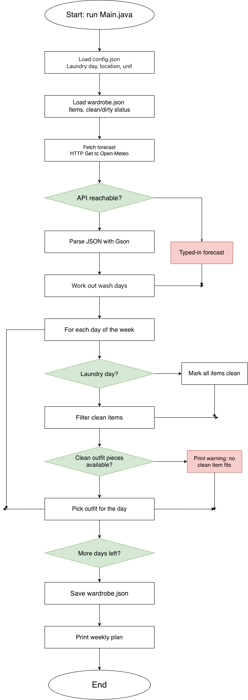

# Outfit Planner

A Java command-line tool that plans my outfits for the week based on the weather forecast and my laundry schedule.

## Project Goal

Right now I decide what to wear each morning by checking the weather and digging through whatever is clean. That is rushed, and it often leaves me with the wrong clothes for the day or a laundry pile full of items I needed.

Outfit Planner pulls the upcoming forecast, combines it with my laundry day and a list of my clothes, and suggests an outfit for each day of the week. It tracks which items are clean or dirty so it only recommends what will actually be available, and it flags days when I'll need something (like a rain jacket) that is in the wash.

## MVP Scope

The MVP (the "Do" quadrant) includes:

1. Load the clothing list from a file (name, category, warmth level, waterproof yes/no).
2. Fetch the multi-day forecast (high/low temperature, rain chance) from the Open-Meteo API.
3. Store the laundry day and mark each item clean or dirty.
4. Generate and print a daily outfit plan using only clean items that match the forecast.

Also in the MVP: a fallback to manually typed forecast values if the API is unreachable, and a warning when no clean item fits a day's weather.

Example output:

```
Mon: 52°F, rain: long-sleeve shirt, jeans, rain jacket
```

## Future Plans (V2.0+)

- Track how often each item is worn and avoid repeats.
- Add or remove clothes from the command line (no manual file editing).
- Suggest outfits by occasion (work, casual, formal).
- Remind me when a needed item won't be clean in time.

## Eisenhower Matrix

|               | Urgent | Not Urgent |
|---------------|--------|------------|
| **Important** | **Do (MVP):** load clothing list; fetch forecast; track laundry day and clean/dirty status; print daily outfit plan from clean items | **Schedule (V2.0+):** wear tracking; add/remove clothes from the CLI; outfits by occasion; reminders when an item won't be clean in time |
| **Not Important** | **Delegate (use a library):** Gson for JSON; `HttpClient` for requests; library for reading/writing data files; `java.time` for dates | **Delete (cut it):** graphical or mobile app; photos or visual closet; AI style recommendations; online shopping suggestions |

## System Diagram



The program loads `config.json` and `wardrobe.json`, fetches the forecast (with a typed-in fallback if the API is unreachable), works out the wash days, then loops over each day of the week to pick a clean outfit. It saves the updated clean/dirty status and prints the weekly plan.

## Tech Stack

- **Language:** Java (command-line application)
- **HTTP:** `java.net.http.HttpClient` (built into Java 11+)
- **JSON:** Gson, for the weather response and the wardrobe/config files
- **Dates:** `java.time` for dates and laundry-day logic
- **Build:** Maven or Gradle to manage the Gson dependency
- **Data storage:** plain JSON files, no database
  - `wardrobe.json`: each item's name, category, warmth level, waterproof flag, and clean/dirty status
  - `config.json`: laundry day, latitude/longitude, and temperature unit
- **External data:** [Open-Meteo forecast API](https://open-meteo.com/) (free, no API key)
- **Tools:** `curl` to test the API, Git and GitHub for version control

## Project Structure

```
outfit-planner/
├── src/        Java source code
├── tests/      tests
├── docs/       design doc, Eisenhower Matrix, system diagram
├── data/       sample wardrobe.json and config.json
├── README.md
└── .gitignore
```

## Usage

Setup and usage instructions will be added as the project is built.
